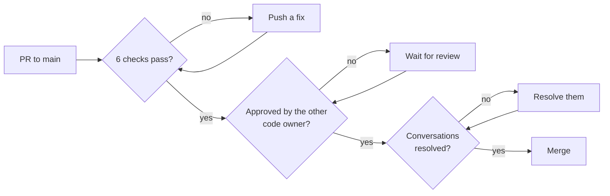
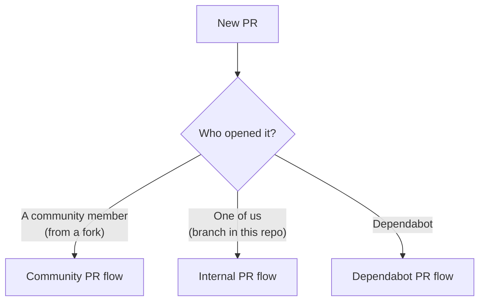
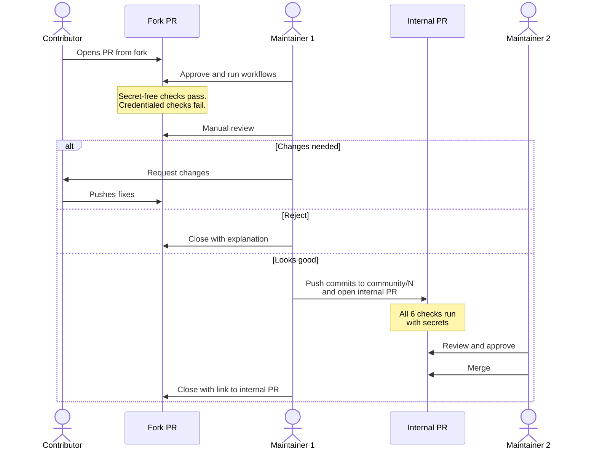
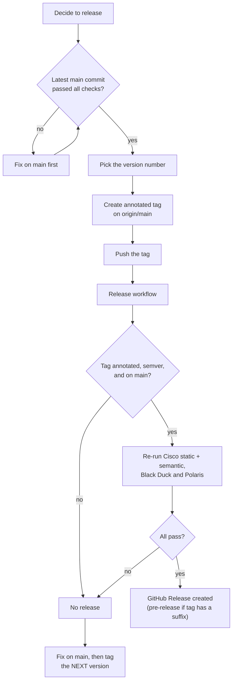

# Maintainer Guide

Day-to-day instructions for the maintainers and code owners, `@prorpy` and
`@SteveSouthwell`. For the reasoning behind each control, see the
[security baseline](security-baseline.md).

## The Rules GitHub Enforces

The rulesets have no bypass list, so nobody can skip these, admins included.
Changing them means editing the ruleset itself, which should go through the same
discussion as any other security change.

- Every change to `main` goes through a PR. Direct pushes, force pushes and
  branch deletion are blocked.
- Six checks must pass, on a branch that is up to date with `main`:
  `Content validation`, `TruffleHog secret scan`, `Cisco skill static scan`,
  `Cisco skill semantic scan`, `Polaris SAST Scan` and `Black Duck SCA Scan`.
- One code owner must approve, and it cannot be the person who pushed the
  latest commit. In practice: **if one of us pushes, the other approves.**
- A new push dismisses earlier approvals.
- All review conversations must be resolved.
- Release tags (`v*`) cannot be deleted or moved once pushed.



## Which Kind of PR Is This?



## Community PR Flow

GitHub never gives repository secrets to workflows from forks. That means the
Cisco semantic scan, Polaris and Black Duck **always fail on a fork PR**. This
is expected; the PR is never merged directly. Instead, after review, one of us
copies the commits into a branch in this repository, where every scan runs.



### Step 1: Approve the workflows

New fork PRs show **"Approve and run workflows"** on the PR page. Only click it
after a quick look at the changed files: the workflows run the contributor's
code, without secrets but with network access.

Never approve workflows for a fork PR that changes `.github/`, `scripts/`,
`requirements-*.txt` or `.pre-commit-config.yaml`. Close it instead; those files
are changed by maintainers only.

### Step 2: Review by hand

The scans help, but your review is the real gate. Check:

- [ ] Files are only under `skills/<skill-name>/`, plus docs if relevant.
- [ ] `name` in the `SKILL.md` frontmatter matches the directory name.
- [ ] The `description` honestly says what the skill does.
- [ ] The instructions do nothing beyond what the description promises. Look
      for hidden commands, data being sent anywhere, or text that tries to
      override the agent's or user's instructions (prompt injection).
- [ ] Helper files (scripts, templates) are readable and necessary. Be very
      suspicious of encoded, minified or binary content.
- [ ] No secrets, credentials, internal URLs or customer data.
- [ ] The three secret-free checks pass: `Content validation`,
      `TruffleHog secret scan` and `Cisco skill static scan`.
- [ ] The contributor ticked the license box in the PR template.

### Step 3: Move it to an internal PR

From an up-to-date clone, with `N` the fork PR number:

```powershell
gh pr checkout N -b community/N
git push origin community/N
gh pr create --base main --head community/N `
  --title "<fork PR title>" `
  --body "Community contribution from #N by @<contributor>."
```

The contributor's commits and authorship are kept unchanged.

### Step 4: Scan, approve and merge

1. Wait for all six checks on the internal PR. The **Cisco semantic scan** is
   the most important one for skills. Read its result, but treat the LLM part
   as advisory: submitted text can try to manipulate it. Static and behavioral
   findings, and your own review, decide.
2. The **other** maintainer reviews and approves. You pushed the branch, so you
   cannot approve it yourself.
3. Merge, then close the fork PR with a comment such as
   "Merged via #M, thank you!".

### If a scan fails on the internal PR

- **Cisco finding:** discuss it on the fork PR with the contributor. Do not
  share raw scanner output publicly; summarise the finding instead. Close the
  internal PR, and repeat step 3 after the contributor pushes a fix.
- **Polaris or Black Duck finding:** same approach.
- **Credential error** (`Request failed authorization`, `403`): a token has
  expired. See [Rotating secrets](#rotating-secrets).

## Internal PR Flow

For our own changes:

1. Create a branch from `main`, commit, push and open a PR.
2. Wait for the six checks.
3. The other maintainer reviews and approves.
4. Merge.

If `main` moves before you merge, update your branch (the **Update branch**
button). This re-runs the checks and dismisses the approval, so the other
maintainer approves again.

## Dependabot PR Flow

Dependabot opens PRs daily for GitHub Actions, Python packages and pre-commit
hooks. All six checks run on them, using the Dependabot copies of the secrets.

1. Check the release notes linked in the PR, especially for the scanners
   (`cisco-ai-skill-scanner`) and anything security-related.
2. Wait for the checks, then approve and merge. Either of us can approve,
   because Dependabot pushed the commits.
3. The same package can appear in a requirements file and in
   `.pre-commit-config.yaml`, for example `cisco-ai-skill-scanner` and
   `pymarkdownlnt`. Dependabot then opens one pip PR and one pre-commit PR.
   Merge both so the versions stay the same.

If only Dependabot PRs fail with a credential error while other PRs pass, the
Dependabot copy of a secret is out of date.

## Publishing a Release

A release is an annotated tag on a commit that is already on `main`. Pushing
the tag starts the **Release** workflow, which re-scans that exact commit and
only publishes if everything passes.



### Step 1: Choose the version

Use semantic versioning:

| Change since the last release | Example |
| --- | --- |
| Fixes to existing skills | `v1.0.0` to `v1.0.1` |
| New skills | `v1.0.1` to `v1.1.0` |
| Renamed or removed skills, or a changed layout | `v1.1.0` to `v2.0.0` |
| A preview, not yet meant for general use | `v1.1.0-preview.1` |

Tags with a suffix (anything after `-`) are published as **pre-releases**.

### Step 2: Check `main`

```powershell
gh api repos/prgs-profservices/ABL_Agent_Skills/commits/main/check-runs `
  --jq '.check_runs[] | "\(.name): \(.conclusion)"'
```

All six checks should show `success`.

### Step 3: Tag and push

```powershell
git fetch origin
git tag -a v1.1.0 -m "ABL Agent Skills 1.1.0" origin/main
git push origin v1.1.0
```

- Always use `-a` (annotated). A lightweight tag is rejected by the workflow.
- Always tag `origin/main`, not your local branch.
- **A pushed tag is permanent.** Double-check the version before pushing.

### Step 4: Watch the workflow

```powershell
gh run list --workflow release.yml --limit 1
gh run watch <run-id>
```

When it succeeds:

```powershell
gh release view v1.1.0
```

Optionally edit the release notes on GitHub, for example to list the new
skills.

### If the release workflow fails

No release is created, and the tag cannot be removed. Fix the cause on `main`
through a normal PR, then tag the next version, for example `v1.1.1`, or
`v1.1.0-preview.2` for a pre-release. The failed tag stays without a release.

## Recurring Checks

| What | When | If it fails |
| --- | --- | --- |
| TruffleHog secret scan | Daily, 04:23 UTC | Possible leak; see below |
| Black Duck scan | Daily, 09:30 UTC | New vulnerability or expired token |
| Dependabot | Daily | Review and merge the PRs |

GitHub only notifies the person who last changed a workflow's schedule about
failed scheduled runs, so check the **Actions** tab regularly as well.

**If TruffleHog finds a secret:** reproduce it locally in a restricted
environment, revoke and rotate the credential first, and only then remove it
from the code. Removing it from Git history alone does not make it safe.

## Rotating Secrets

Each secret exists twice: as an **Actions** secret, used by our PRs and
scheduled runs, and as a **Dependabot** secret, used by Dependabot PRs. Always
update both.

| Secret | Used by |
| --- | --- |
| `BLACKDUCK_TOKEN` | Black Duck |
| `POLARIS_ACCESS_TOKEN` | Polaris |
| `SKILL_SCANNER_LLM_API_KEY` | Cisco semantic scan (Nuclia NUA key) |

```powershell
gh secret set BLACKDUCK_TOKEN --repo prgs-profservices/ABL_Agent_Skills
gh secret set BLACKDUCK_TOKEN --app dependabot `
  --repo prgs-profservices/ABL_Agent_Skills
```

Paste the value when prompted. Never put it in a command line, file, chat or
issue. Then re-run the failed workflow to confirm.

## Security Reports

Reports arrive as private advisories under **Security > Advisories**:

1. Acknowledge the report in the advisory.
2. Reproduce it and fix it through a normal internal PR, so all checks run.
   Keep the PR description general until the advisory is published.
3. Publish a release with the fix.
4. Publish the advisory.

If a released skill turns out to be harmful, remove or fix it on `main`
immediately, release a new version, and mention the affected versions in the
advisory.

## Settings Reference

| Setting | Where |
| --- | --- |
| `main` ruleset (PR, approvals, checks) | Settings > Rules > Rulesets |
| `Release tags` ruleset (`refs/tags/v*`) | Settings > Rules > Rulesets |
| Fork PR workflow approval | Settings > Actions > General |
| Code owners | `.github/CODEOWNERS` |
| Secrets (Actions and Dependabot) | Settings > Secrets and variables |
